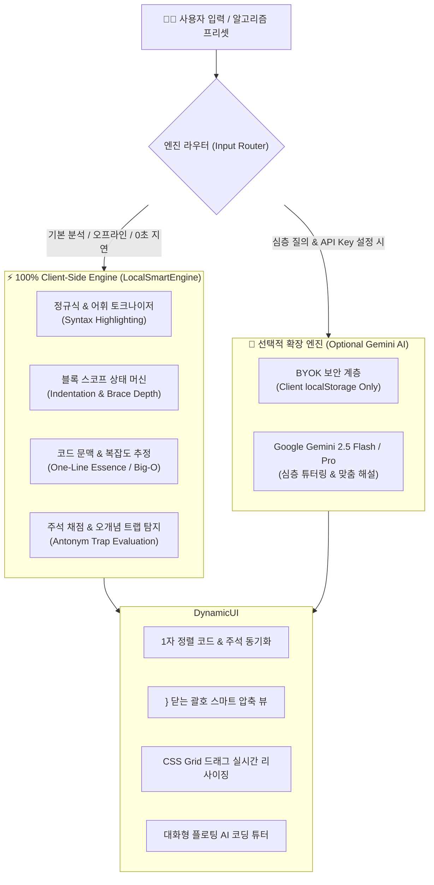

# 🔍 CodeLens — 듀얼 엔진 기반 코드 시각화 & 인터랙티브 학습 도구

> **"코드가 읽히지 않는 학습자를 위한 1자 정렬 해부 · 블록 스코프 추적 · 주석 채점 & 하이브리드 AI 튜터링 플랫폼"**

[](https://sikhesung.github.io/codeLens/)
[](./CodeLens.exe)
[](https://github.com/sikhesung/codeLens/actions)
[](https://nodejs.org/)

---

## 📌 1. 프로젝트 배경 및 문제 정의 (Why CodeLens?)

프로그래밍 초심자나 새로운 알고리즘을 학습하는 개발자는 다음과 같은 공통적인 병목을 마주합니다:
1. **시각적 인지 과부하**: 들여쓰기 깊이가 깊어지거나 `for/while` 중첩 루프가 시작되고 끝나는 지점을 한눈에 파악하기 어렵습니다.
2. **닫는 괄호(`}`)의 시각적 노이즈**: C/Java/JavaScript 등 중괄호 기반 언어에서 닫는 기호가 줄을 차지하며 시각적인 혼란을 유발합니다.
3. **단순 LLM 서비스의 한계**:
   - ChatGPT나 Gemini 등 단순 대화형 AI에 코드를 붙여넣으면 줄 번호와 설명이 어긋나기 쉽고, 설명이 너무 장황합니다.
   - 웹 데모에 개발자의 API 키를 심어둘 경우 **보안 유출 위험과 과도한 API 과금(Abuse)** 문제가 발생합니다.

**CodeLens**는 이러한 문제를 해결하기 위해 **순수 클라이언트 기반의 경량 정적 파서(0원, 무지연)**와 **BYOK(Bring Your Own Key) 기반의 LLM 심층 해석**을 결합한 하이브리드 아키텍처로 설계되었습니다.

---

## 🏗️ 2. 시스템 아키텍처 (System Architecture)



---

## 🌟 3. 핵심 기술 기능 (Core Capabilities)

### 1) ⚡ 한 줄 관통 요약 & 실시간 구문 강조
- **원클릭 관통 요약**: 긴 설명 전에 코드의 핵심 작동 원리와 최종 목적을 단 1초 만에 꿰뚫어 볼 수 있는 배너 제공.
- **초경량 토크나이징 엔진**: 외부 무거운 하이라이터 라이브러리(Prism.js 등) 없이 순수 정규식 기반으로 예약어, 문자열, 숫자, 함수 호출부를 실시간 컬러링.

### 2) 📐 1자 정렬 해부 & 닫는 중괄호(`}`) 스마트 정돈
- **1자 정렬 모드**: 들여쓰기를 제거하여 코드와 해설을 앞쪽에 밀착 정렬함으로써 시선 이동 최소화.
- **`}` 닫는 괄호 스마트 뷰**: `}`만 단독으로 존재하는 줄의 불필요한 공백과 설명을 제거하고, 컴팩트한 높이와 은은한 닫힘 표시(`} · · · 닫힘`)로 시각적 노이즈 제거.

### 3) 🔁 작동 블록 스코프 해부 (Block Decomposition)
- 함수, `for`, `while`, `if` 분기 등의 시작 줄부터 끝 줄까지의 범위를 인덴트 및 괄호 스택으로 추적하여 하나의 묶음 카드 형태로 역할과 실행 경로 제시.

### 4) 🎯 지능형 주석 채점소 & 오개념(Antonym) 트랩 검증
- 학습자가 작성한 주석을 정답 모델과 비교하여 100점 만점 및 S~C 등급 산출.
- `+=`를 '뺀다'로 오해하거나, `//`를 '실수 나눗셈'으로 혼동하는 흔한 오개념 패턴(Antonym Traps)을 규칙 기반으로 탐지하여 교정 피드백 제공.

### 5) 🛠️ 모든 UI 마우스 드래그 커스텀
- CSS Grid 변수(`--code-col-width`, `--comment-gap`)를 마우스 드래그 이벤트와 바인딩하여 브라우저 리플로우(Reflow) 지연 없이 실시간 영역 조절 가능.

---

## 💡 4. 핵심 기술적 의사결정 & 문제 해결 (Key Engineering Decisions)

### 1. [보안 & 비용] BYOK (Bring Your Own Key) 패턴 도입
* **문제**: 불특정 다수가 접속하는 웹 데모에 개발자 개인 API 키를 서버/클라이언트에 탑재할 경우, **키 탈취 및 비정상 트래픽으로 인한 과금 폭탄(API Abuse)** 위험 존재.
* **해결**:
  1. 기본 분석 및 프리셋은 브라우저 내장 `LocalSmartEngine`으로 100% 오프라인 처리 (비용 0원, 지연시간 0ms).
  2. 심층 LLM 분석은 **BYOK** 패턴을 적용하여, 사용자가 직접 입력한 키를 브라우저의 `localStorage`에만 격리 보관. 깃허브나 외부 서버로의 전송 원천 차단.

### 2. [성능 & UX] CSS Grid Live Calc 기반 드래그 리사이징
* **문제**: 일반적인 DOM Width 조절 방식(`elem.style.width = ...px`)은 마우스 무브 시마다 브라우저의 무거운 리플로우(Reflow)와 리페인트(Repaint)를 유발하여 버벅임 발생.
* **해결**:
  - 부모 컨테이너의 CSS Grid 템플릿에 CSS 변수(`--code-col-width`)를 바인딩하고, 드래그 핸들러에서 CSS 변수 값만 `requestAnimationFrame` 주기로 갱신하여 60FPS의 부드러운 드래그 UX 달성.

### 3. [배포 경량화] Electron 대비 99.8% 용량 감축 (C# WebView2)
* **문제**: 웹 앱을 데스크톱 실행파일로 패키징할 때 흔히 쓰이는 Electron은 번들 크기가 150MB~200MB에 달해 단순 유틸리티로는 지나치게 무거움.
* **해결**:
  - Windows에 기본 내장된 Microsoft Edge Chromium 엔진(WebView2)을 활용하는 C# 초경량 런처(`CodeLensLauncher.cs`)를 설계.
  - 빌드 결과물 크기를 **180KB**로 압축하여 추가 런타임 설치 없이 초고속 단독 실행 보장.

---

## 🧪 5. 자동화 테스트 & CI/CD 파이프라인 (Testing & CI/CD)

CodeLens는 코드의 안정성과 신뢰성을 검증하기 위해 **Node.js Native Test Runner** 기반의 단위 테스트 제품군을 보유하고 있습니다.

```bash
# 단위 테스트 실행 (외부 의존성 0개, 초고속 구동)
npm test
```

### 📋 테스트 커버리지 목록 (`test/parser.test.js`)
* **언어 자동 감지**: C, Java, JavaScript, Python 문법 패턴 감지 검증
* **블록 단위 파싱**: Python 인덴트 기반 함수/루프 범위 및 JS 중첩 블록 스코프 스택 검증
* **어휘 정제**: 인라인 주석(`//`, `#`) 및 공백 분리 정확도 검증
* **정적 분석**: 한 줄 관통 요약 생성 및 시간 복잡도 도출 검증
* **구문 강조**: 키워드, 문자열, 숫자 토큰 태깅 정밀도 검증
* **주석 채점**: 사용자 주석 점수 환산 및 반대 개념(오개념 트랩) 탐지 검증

### 🚀 CI/CD 파이프라인 (`.github/workflows/pages.yml`)
- `main` 브랜치에 코드가 푸시되면 GitHub Actions 가상머신에서 **12개 단위 테스트 자동 수행**
- 모든 테스트가 통과(`Passing`)한 경우에만 GitHub Pages 프로덕션 환경으로 무중단 배포 진행

---

## 📁 6. 프로젝트 디렉토리 구조

```
CodeLens/
├── .github/workflows/
│   └── pages.yml              # CI 단위 테스트 및 GitHub Pages 자동 배포 워크플로우
├── test/
│   └── parser.test.js         # LocalSmartEngine 12개 핵심 단위 테스트 슈트
├── app.js                     # UI 인터랙션, 드래그 매니저, 렌더링 오케스트레이션
├── sample_data.js             # LocalSmartEngine (어휘 분석기, 블록 스코퍼, 알고리즘 프리셋)
├── gemini_service.js          # Gemini REST API 클라이언트 & BYOK 로컬 키 관리자
├── index.html                 # 시맨틱 마크업 & 대시보드 레이아웃
├── styles.css                 # CSS Grid, 다크 테마, 가변 드래그 스타일
├── CodeLensLauncher.cs        # C# .NET WebView2 초경량 윈도우 런처 소스
├── build_exe.py               # 단독 실행파일(.exe) 원클릭 빌드 스크립트
├── CodeLens.exe               # 180KB 무설치 윈도우 단독 실행 파일
├── package.json               # 프로젝트 매니페스트 & 테스트 스크립트
└── README.md                  # 프로젝트 엔지니어링 문서
```

---

## 🚀 7. 실행 방법

### 1) 웹에서 바로 체험
👉 **[CodeLens Web Live Demo](https://sikhesung.github.io/codeLens/)**

### 2) Windows 데스크톱 무설치 실행
* 저장소 내의 [`CodeLens.exe`](./CodeLens.exe) 다운로드 후 더블클릭 (설치 과정 없음)

### 3) 로컬 개발 & 테스트
```bash
# 1. 저장소 클론
git clone https://github.com/sikhesung/codeLens.git
cd codeLens

# 2. 단위 테스트 실행
npm test

# 3. 로컬 브라우저로 index.html 열기
```

---

## 🔮 8. 향후 로드맵 (Future Roadmap)

- [ ] **WASM 기반 AST 파서 고도화**: 정규식 기반 파서를 WebAssembly 컴파일된 `Tree-sitter` 파서 엔진으로 확장하여 임의의 복잡한 중첩 람다 및 다중 상속 문법 100% 파싱 지원.
- [ ] **Python/C AST 추상 문법 트리 비주얼 그래프**: 텍스트 블록뿐 아니라 노드 다이어그램(Interactive AST Graph) 시각화 지원.
- [ ] **VS Code Extension 포팅**: 웹 브라우저를 벗어나 개발자가 에디터 내에서 인라인 코드 렌즈 형태로 바로 활용할 수 있도록 플러그인화.
